# `whoami`

**Cybersecurity · Network Engineering · Backend Development**

<table><tr>
<td valign="top"></td>
<td valign="top"></td>
</tr></table>

---

### `./current_focus.sh`
- Security monitoring, detection engineering and network visibility
- Python backend development and automation
- Linux, infrastructure and secure system design

### `./find_me.sh`
- GitHub: [@YOUR_GITHUB_USERNAME](https://github.com/01danimo)

> Replace the placeholder links and profile details in `data/profile.json` before publishing.
